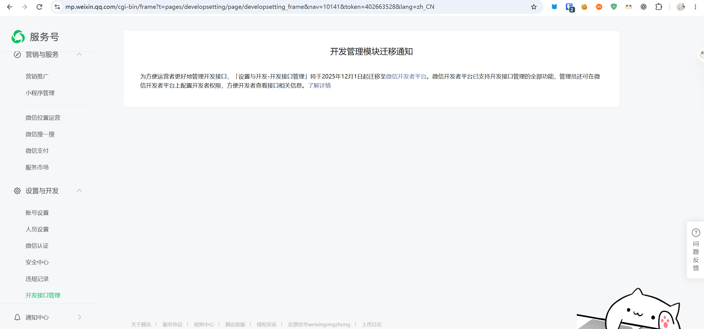
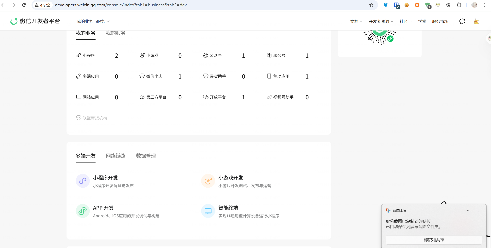
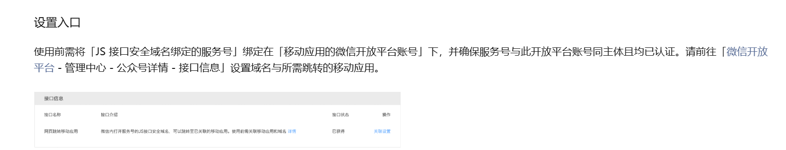
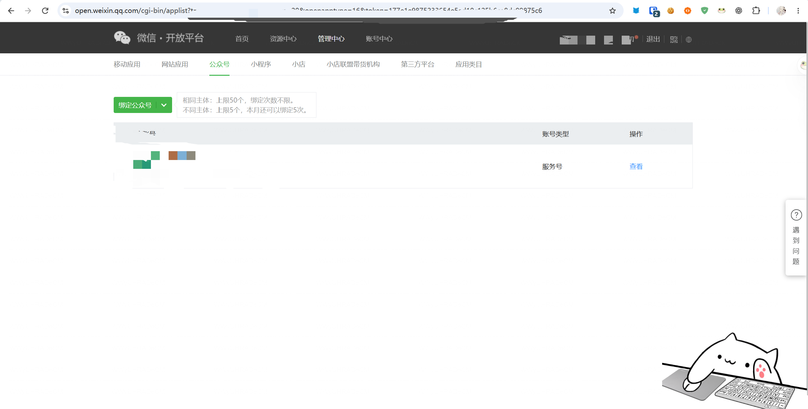
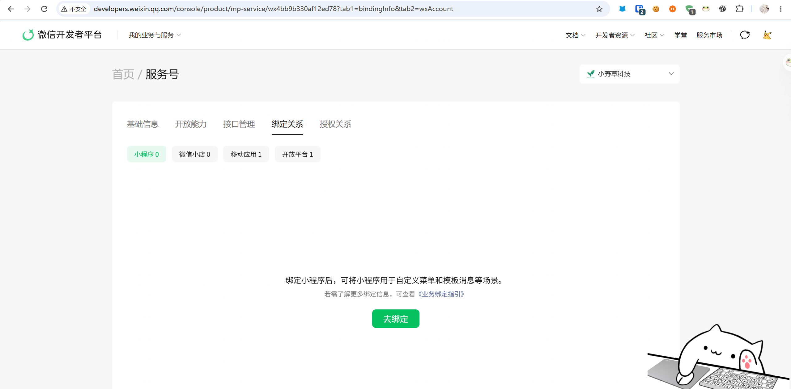
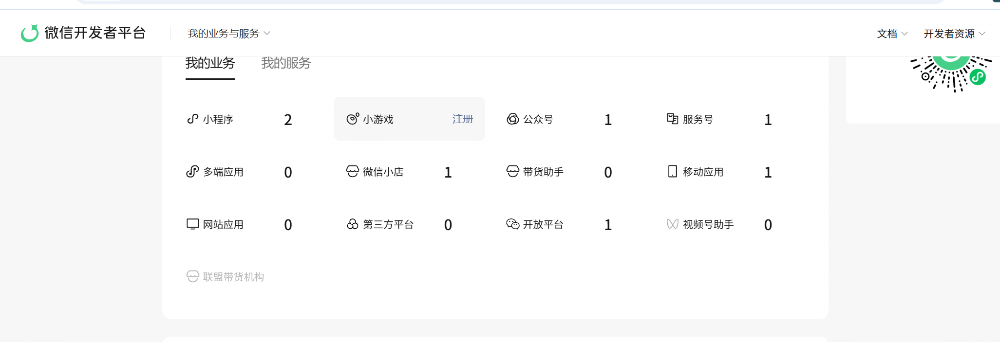
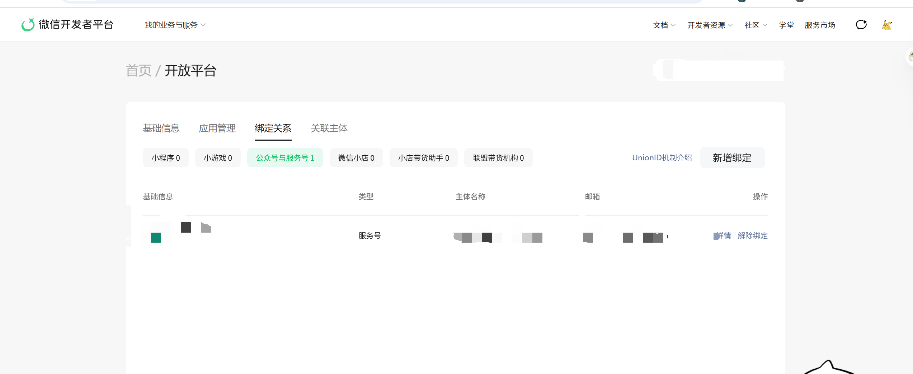
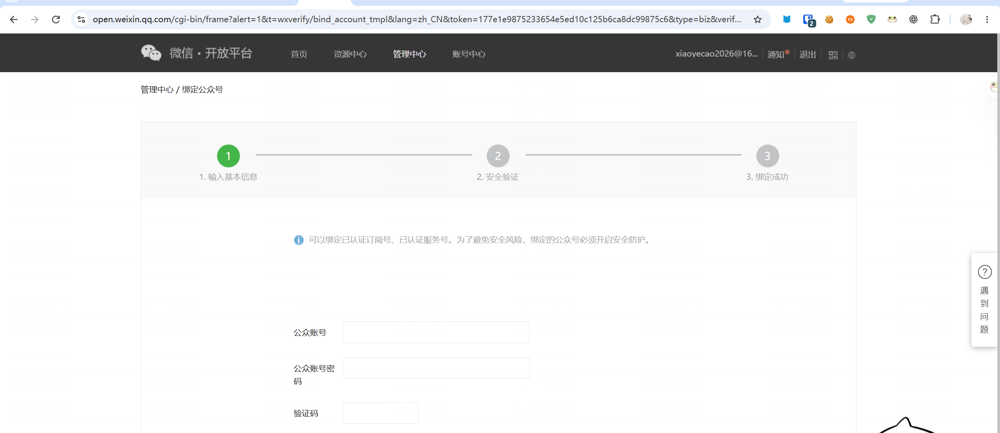
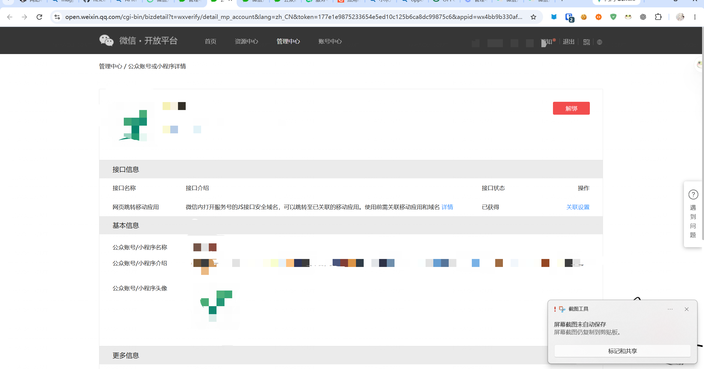
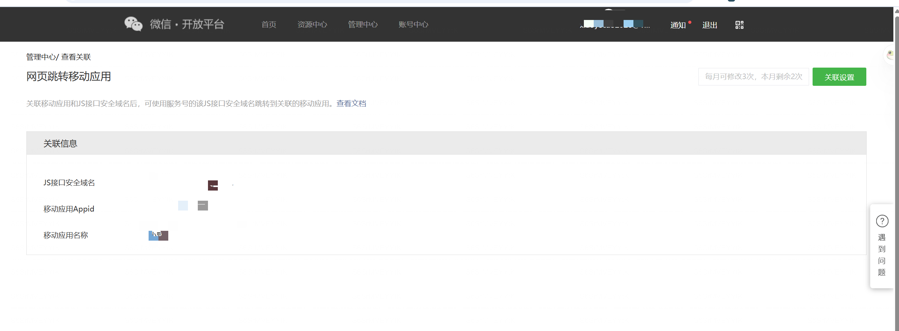

最近，公司要做一个拉新的网页活动，自然需要对接微信。除了网页卡片，还有一个很重要的功能，就是实现从微信网页跳转到 APP。

说到这个，我真的想骂人。微信的几个平台杂七杂八的，各种文档也掺在一起。昨天为了这个功能，我加了三个小时的班。

先让我吐槽一下，我们来看看微信目前有几个平台：

**1. [微信服务号](https://mp.weixin.qq.com/)**

**2. [微信开发者平台](https://developers.weixin.qq.com/)**

**3. [微信开放平台](https://open.weixin.qq.com/)**

## 网页跳转 APP

按照[微信官方文档](https://developers.weixin.qq.com/)的说法，我事先认证了服务号，也配置好了相关 SDK、代码和 JS 接口安全域名。但实际调试的时候，还是会报错：`"launch:fail_check fail"`

按照官方文档所说：

### 事件

| **名称** | **冒泡** | **返回值**                                         | **备注**                                   |
| -------- | -------- | -------------------------------------------------- | ------------------------------------------ |
| ready    | 否       |                                                    | 标签初始化完毕，可以进行点击操作           |
| launch   | 否       | { appId: string, extInfo: string }                 | 用户点击跳转按钮并对确认弹窗进行操作后触发 |
| error    | 否       | { errMsg: string, appId: string, extInfo: string } | 用户点击跳转按钮后出现错误                 |

备注：`error` 事件返回值 `errMsg` 说明如下。

| **errMsg**               | **说明**                                                                                                                                                                                 |
| ------------------------ | ---------------------------------------------------------------------------------------------------------------------------------------------------------------------------------------- |
| "launch:fail"            | 当前场景不支持跳转，或 Android 上该应用未安装，或 iOS 上用户在弹窗上点击确认但该应⽤未安装                                                                                               |
| "launch:fail_check fail" | 校验 App 跳转权限失败，请确认是否正确绑定 AppID 以及域名是否完全一致（详见 [《微信内网页跳转APP功能》](https://developers.weixin.qq.com/doc/oplatform/Mobile_App/WeChat_H5_Launch_APP)） |

所以，问题又回到了 APP 的跳转权限上。按照官方给的文档，我缺少了这一步：

但当我打开开放平台，却没有看到可以绑定的公众号（当时没有截图，凑活看）。

点左上角的绑定，也找不到可以绑定的账号，输入服务号的账号密码也无法绑定。

事情到了这里，我就在想，是不是服务号和公众号本质上不一样？然后我试着注册了一个公众号，但发现管理界面和服务号一模一样，而且还需要我重新花三百元进行认证……nmd，所以这一点可以排除了。

那就只剩下一条思路了：是不是服务号和移动应用绑定的问题？

然后我去了微信开发者平台。对，没错，在微信服务号管理界面是无法查看绑定关系和开发设置的。我当时看到移动应用绑定数为 0，就点击去绑定，结果依旧直接跳到了上面的开放平台。好像绕了一圈，又回到了起点。

然后我在浏览器里一顿搜索，又看了一遍文档，结果……还是没有找到。

直到最后，我抱着死马当活马医的态度一顿瞎点，点到了下面的开放平台：

然后在绑定关系里面，终于发现了可以绑定服务号的地方。

绑定完成后，经过测试还是不能跳转，于是我又回看了一下文档。

这时候还需要去开放平台，就能看到自己的账号已经被绑定上了。

有点忘了，也可能是需要手动查找并确认绑定。

然后我们就可以进入管理页了。

然后你会发现，还需要再配置一遍 JS 接口安全域名和 AppID。

最后终于成功实现了跳转功能。不过这个 JS 接口安全域名，我记得总共已经设置了三遍，服务号、移动应用什么的都需要设置，可以说无比麻烦。

最后还是想吐槽一下微信这恶心人的机制：为什么好好的功能要分散到三个不同的平台？最古老的那个开放平台，甚至不能微信扫码，只能用邮箱密码登录。其他平台也是各有各的毛病，太恶心了。
